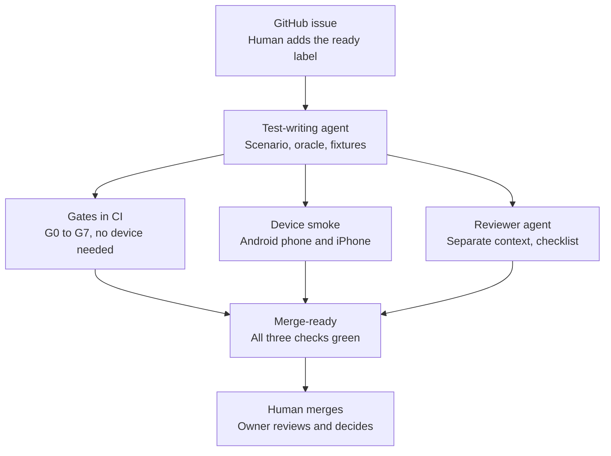

# Agent-Built---Gate-Verified-Mobile-Tests

# Agent-Built, Gate-Verified Mobile Tests

AI agents write mobile tests fast, but their checks often can't fail.  This project's predecessor had 16 green smoke tests, and several passed on screens they never opened.

In this framework, every agent-written check must pass on the right screen and fail on the wrong one before a human sees it.  Agents propose, deterministic gates decide, and a human approves.  It runs black-box against a production consumer mobile app on a physical Android phone and iPhone.

## How a test gets merged

Any red check sends the work back to the agent.  Agents cannot edit the gates, and nothing merges without a human.

## Three things the gates caught

1. **A loose oracle, rejected for real.**  The test-writing agent was told to write the simplest check first ("a card exists").  The negative-control gate rejected it because it also passed on a day the state it was meant to detect never occurred.
2. **An iOS check that never read the screen.**  A control sat inside the screen's marker, so the first check survived the page content being emptied.  The gate caught it, and the check now requires the actual page.
3. **A real accessibility defect in the app.**  A status card was announced to screen readers with the wrong state.  A separate triage agent later matched a red run to that known defect instead of filing a duplicate, and proposed a quarantine for a human to approve.

## Results so far

| Measure | Result |
|---|---|
| Scenarios | 25 (20 on the production app, 5 mocked edge cases); 16 also run on a physical iPhone |
| Checks per CI run | 106 positive, 390 negative, across both platforms |
| Requirements traced from a job posting | 28: 21 built, 3 partial, 4 strategy |
| Predecessor's checks through the negative gate | 6 of 6 rejected |
| Agent time per issue | Median 11.5 min to merge-ready, first eight issues |
| Accessibility audit | 26 Android and 28 iOS screens |

## My part, and the limits

I designed the oracle contract, the gates agents cannot edit, the agent roles, and the review checklist, and I made every merge decision.  Agents wrote the scenarios, oracles, and fixtures from GitHub issues.

Limits: one device per platform, one recorded build each, self-healing shown on a simulated build change, and mocking on a sample app rather than the production app.
